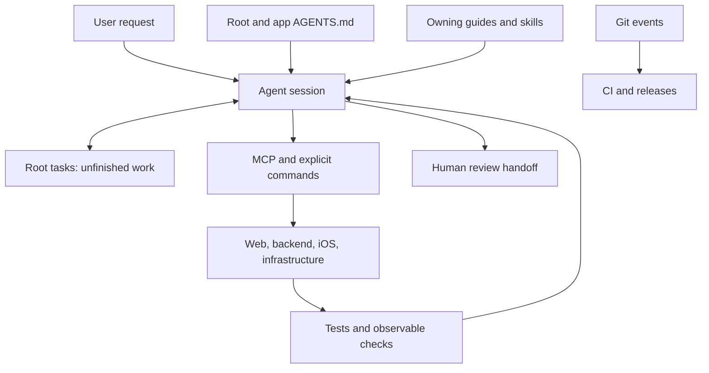

# Agent harness architecture

The harness is the repository's instructions, workflows, task files, tool connections, and checks. The agent client provides the model, tool execution, permissions, and personal plugins; this repository has no separate agent runtime.

Reading guidance does not execute a hook or grant tool permission. The agent performs the workflow; scripts and CI enforce their own checks.

## Ownership and discovery

| Home | Owns |
| --- | --- |
| [Root AGENTS.md](../AGENTS.md) and app policies | Shared boundaries and routes to platform rules |
| [Docs index](README.md), root `docs/`, and app docs | Shared knowledge and platform-specific invariants, with one maintained home per topic |
| [Root .agents/skills](../.agents/skills/) | Reusable execution procedures |
| [tasks/](../tasks/README.md) | Unfinished requirements, decisions, progress, evidence, and next action |
| [.codex/config.toml](../.codex/config.toml) | Project MCP startup and connection definitions |
| Scripts, test suites, and [.github/workflows](../.github/workflows/) | Executable checks and automation |

Start sessions at the monorepo root. Shared docs live under root `docs/`; platform detail stays beside its app. Keep `AGENTS.md` short and route to the owning guide. Root skills are also discoverable from app subdirectories. Personal/plugin skills and credentials are outside the maintained repository harness.

## Rules and skills

Rules describe constraints that apply whenever an area is edited: module boundaries, generated-file ownership, product language, and authorization. Keep them in the owning guide. Skills describe reusable jobs such as refinement, implementation, verification, simulator launch, or deployment. A skill links to rules rather than copying them. Metadata under `agents/` does not create worker agents.

Browse the [skills overview](skills.md) for every repository skill and its community source. All repository skills have one canonical home under root `.agents/skills/`:

- Custom workflows use `lg-` names, with platform prefixes when relevant.
- Community skills are installed through [skills.sh](https://skills.sh/) and recorded in the tracked [skills-lock.json](../skills-lock.json). Preserve upstream contents; keep repository-specific rules in our guides.
- Use [lg-improve-harness](../.agents/skills/lg-improve-harness/SKILL.md) to improve custom workflows, policy, rules, and guidance. Community installation updates follow [their separate procedure](skills.md#update-community-skills). Use [lg-maintain-docs](../.agents/skills/lg-maintain-docs/SKILL.md) to audit and trim guidance against source.

## Task and verification flow

The [task workflow](agents/task-workflow.md) owns draft → refinement → implementation → verification and the [human review handoff](agents/human-review.md). Root `tasks/` retains unfinished work only. Authorized direct implementation proceeds with a proportionate saved plan; phase boundaries do not add approval gates.

Use the owning platform's tools and validation: [iOS workflows](agents/ios-workflows.md), [backend validation](../backend/docs/agents/validation.md), [web validation](../web/docs/agents/validation.md), and [browser access](agents/browser-access.md). The [API guide](agents/api-contract.md) owns backend-to-generated-client flow. The [runtime guide](agents/runtime-and-deployment.md) owns service commands, including the volume reset performed by `scripts/run`.

Report actual evidence: build, tests, app launch, service health, and a live user journey establish different things. Documentation-only changes need link, metadata, source-claim, and routing checks; they do not require an app build. No separate subagent or reviewer process is required.

## Hooks and automation

The checked-in configuration enables no agent lifecycle/edit hooks. CI and explicit helpers are separate:

| Mechanism | Behavior and source |
| --- | --- |
| iOS agent hooks | [hooks.json](../ios-app/.agents/hooks.json) is empty; [local config](../ios-app/.agents/config.toml) disables hooks |
| Local Swift lint | [Changed-line lint](../ios-app/scripts/lint-swift-changes.py) runs explicitly or in CI; the historical [hook entry point](../ios-app/.agents/hooks/swiftlint-fix-changed.sh) delegates to it without rewriting files |
| GitHub Actions | [CI/CD](agents/ci-cd.md) owns builds, tests, artifact checks, and release automation; release workflows can publish images, deploy, and push tags |
| Community skills | [Weekly/manual workflow](../.github/workflows/update-community-skills.yml) refreshes upstream skills and commits validated results directly to `main`; independent of task execution |
| Xcode Cloud | [Post-clone](../ios-app/CI_scripts/ci_post_clone.sh) sets build preferences and can push a version tag when `GITHUB_WRITE_PAT` is configured; [pre-build](../ios-app/CI_scripts/ci_pre_xcodebuild.sh) writes local build secrets. Both skip work when `TEST_RUNNER_CI=TRUE` |

Local Git hooks, client settings, and remotely managed Xcode Cloud workflows can add behavior outside checked-in configuration. Inspect them when relevant; a helper stored under `hooks/` is not evidence that an event invokes it.

## MCP and client boundary

The [Codex configuration](../.codex/config.toml) connects native Xcode (`xcrun mcpbridge`), Coolify, Maestro, shadcn, and GoDaddy. The [compatibility configuration](../.agents/config.toml) repeats connections for other clients; app-local files may differ. Inspect tools actually exposed in the session rather than assuming every client merges these files or every configured server is connected.

Connections do not install CLIs, grant account access, or schedule work. The Coolify [auth helper](../scripts/coolify-mcp-auth-headers) reads `COOLIFY_MCP_TOKEN` from the ignored root `.env`; keep real credentials outside Git and restrict that file with `chmod 600 .env`. [iOS harness setup](../ios-app/Docs/agent-harness.md) owns Xcode connection details.

Xcode Repository guidance includes custom `lg-` skills and repository documentation; community skill packages are excluded. When repository-owned guidance files move, repair callers and refresh the [Xcode guidance navigator](../ios-app/Docs/SETUP.md#repository-guidance-in-the-navigator). Add executable hooks only for concrete failures they can reliably detect.
