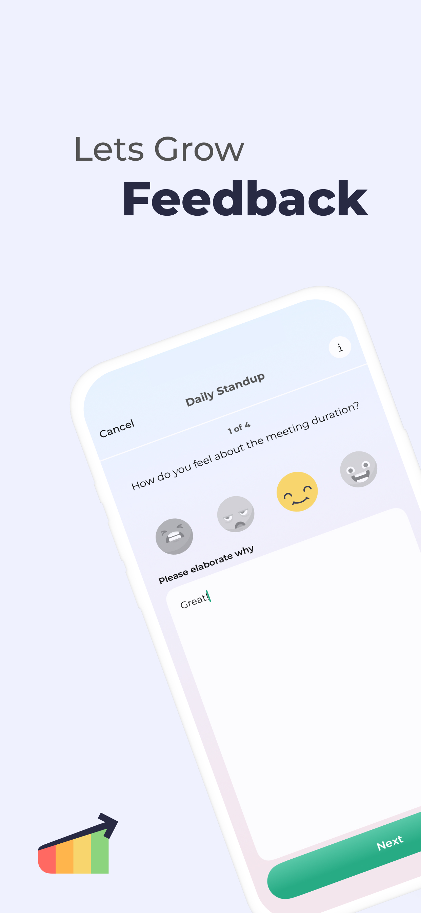
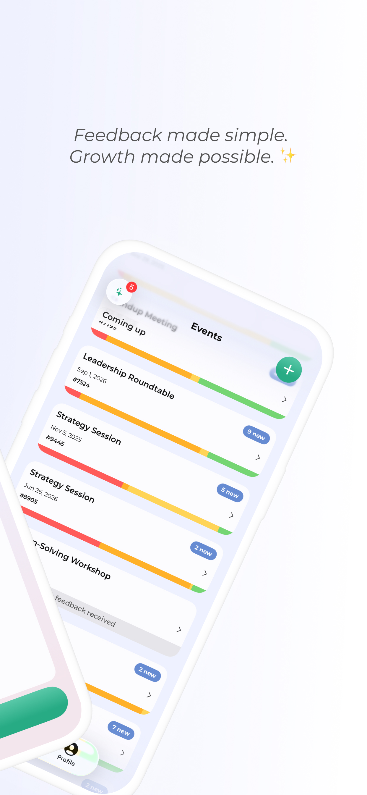
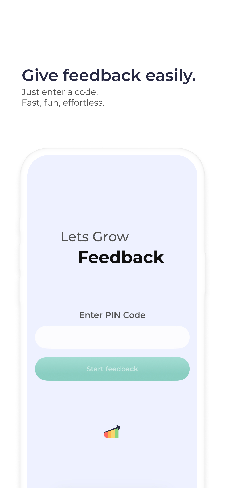
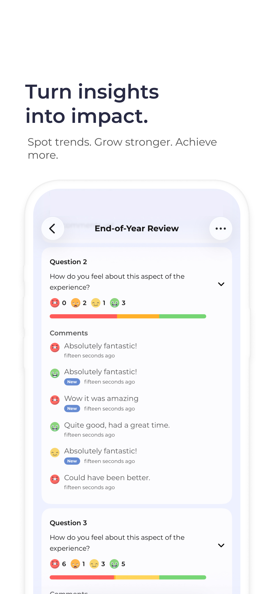
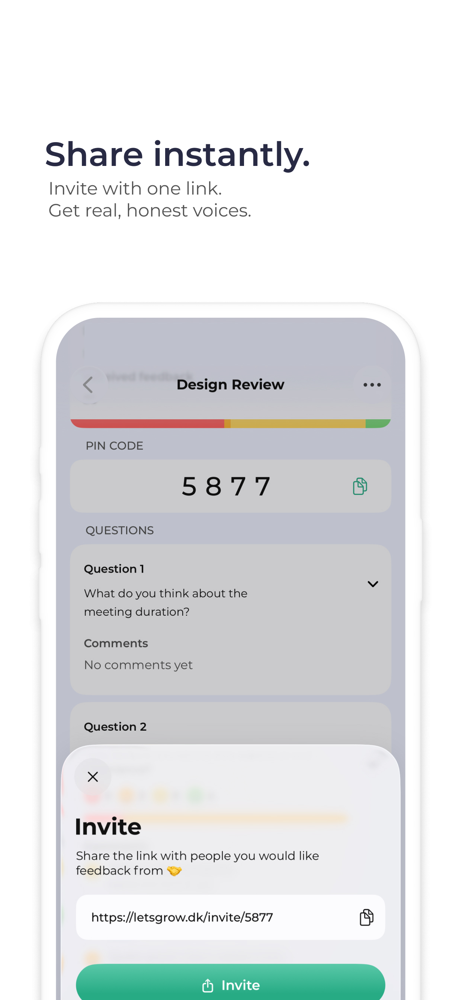
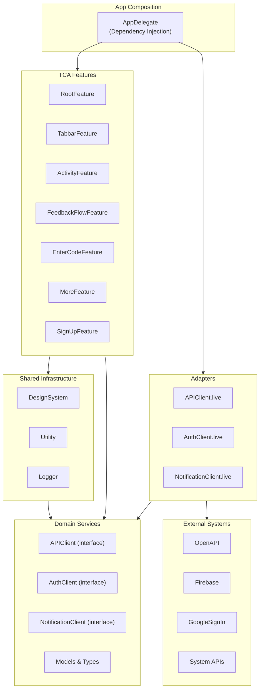

# Lets Grow: Feedback iOS App


This repository contains the source code for the **Lets Grow: Feedback** iOS app, available on the [App Store](https://apps.apple.com/us/app/lets-grow-feedback/id6742420307).  
The app is 100% SwiftUI, [The Composable Architecture (TCA)](https://github.com/pointfreeco/swift-composable-architecture) and leverages iOS 26’s **Liquid Glass** effects.

<p float="left">
  
  
  
  
  
</p>


---

## 🔧 Requirements
- Swift 6.2  
- Xcode 27
- iOS 26  
- SwiftLint (`brew install swiftlint`)


## 🗂 Project structure

```
ios-app/
  App/                         # App entry, AppDelegate, Composition Root
  Modules/
    Sources/
      RootFeature/             # App root reducer & navigation
      EnterCodeFeature/        # Join flow
      FeedbackFlowFeature/     # Feedback screens and flow
      ActivityFeature/           # Event list/detail/create
      MoreFeature/             # Settings/account
      SignUpFeature/           # Sign up
      TabbarFeature/           # Tab coordination
      Domain/                  # Models, errors, service interfaces 
      Adapters/                # Live implementations (API, Firebase, etc.)
      OpenAPI/                 # Generator config + generated client
      DesignSystem/            # Theme, styles, reusable views
      Logger/, Utility/, InfoPlist/  # Cross‑cutting utilities
    Tests/                     # Reducer & snapshot tests
  Resources/                   # Assets, launch screen, localization
  Docs/                        # Documentation, screenshots, push samples
```

See also: `ios-app/Modules/Package.swift` for module targets and dependencies.


---

## 🔌 API Layer

The backend generates the canonical API contract at `contracts/openapi/feedback-api.yaml`; the iOS transport client is generated from that contract.
This ensures the client stays in sync with the backend contract.

- The generated client and generator configuration live under `ios-app/Modules/Sources/OpenAPI/`.
- Committed generated Swift sources live under `ios-app/Modules/Sources/OpenAPI/GeneratedSources/`.
- Regenerate the backend contract, TypeScript client, and Swift client from the monorepo root with `./scripts/generate-api-artifacts.sh`.
- The live `APIClient` is injected via TCA dependencies.

---

## 🧪 Testing

For a complete backend and simulator run, use `$letsgrow-ios-localhost`. To build a Release simulator app against the existing Coolify deployment, use `$letsgrow-ios-production`. See [build/run workflows](Docs/agent-harness.md#build-and-run-workflows).

- Unit and reducer tests: `ios-app/Modules/Tests/`
- Snapshot tests via `swift-snapshot-testing`
- The `Feedback Localhost` scheme uses the shared `UnitTests` plan with `AppTests` and `InsightsTests`.
- Agent build, test, launch, and UI verification use the [simulator workflow](.agents/skills/letsgrow-ios-run-simulator/SKILL.md). See the [harness overview](Docs/agent-harness.md) for Xcode MCP setup and lint commands.


---

## ⚙️ Configuration

Runtime configuration is provided via `Info.plist` keys and read by a small wrapper in `InfoPlist`.

Required keys:

| Key | Example | Purpose |
| --- | --- | --- |
| `API_BASE_URL` | `api.myhost.com` | Backend host |
| `API_SCHEME` | `https` | Backend scheme |
| `WEB_BASE_URL` | `app.myhost.com` | Web deep link host |
| `WEB_SCHEME` | `https` | Web scheme |
| `SUPPORT_EMAIL` | `support@myhost.com` | Support link |
| `APPSTORE_ID` | `1234567890` | App Store links |

Schemes select different environments (Prod/Debug/Localhost/Mock) using `.xcconfig` under `ios-app/App/Config/`.

---

## 🐞 Debugging & Preview

- In `DEBUG` builds a debug overlay (`DebugMenuView`) is available.
- Dedicated preview apps exist under `ios-app/PreviewApps/` for focused UI flows.


---

## 🔔 Notifications

- Push is enabled via `ios-app/App/Entitlements.entitlements`.
- Sample payloads and manual notification-testing instructions are in [Docs/push_notifications/](Docs/push_notifications/README.md).
- Local agent simulator operations follow [the iOS harness policy](AGENTS.md).


---

## 🧰 CI

- GitHub Actions builds the iOS app, runs both unit-test targets, and gates changed-line lint in the path-filtered `iOS` workflow. See [CI setup and cost assumptions](Docs/agent-harness.md#ci).
- The existing `CI` workflow separately verifies generated Swift OpenAPI sources against the canonical contract.
- `ios-app/CI_scripts/` contains separate Xcode Cloud hooks; GitHub Actions does not invoke them.
- Xcode Cloud hooks resolve app files under `CI_PRIMARY_REPOSITORY_PATH/ios-app/`. The pre-build hook writes environment-provided secrets to `ios-app/App/Config/secrets.xcconfig`.
- The post-clone hook optionally pushes a version/build Git tag to the checkout's `origin` when `GITHUB_WRITE_PAT` is configured. Internal testing does not require this token; without it, tagging is skipped. The token must have write access to the monorepo if tagging is enabled.


## 🏗️ Architecture

The app uses a **TCA-based modular architecture** built with Swift Package Manager.  
Features are self-contained modules that compose together to create the full app experience.

### How It Works

**TCA Features** (`RootFeature`, `EnterCodeFeature`, `FeedbackFlowFeature`, etc.) are the main building blocks:
- Each feature manages its own state, business logic, and UI using TCA patterns
- Features can embed child features and share state via `@Shared`
- All user interactions and system events flow through TCA actions

**Domain Services** provide clean interfaces for external interactions:
- `APIClient`, `AuthClient`, `NotificationClient` defined as protocols
- Features call these services via TCA's dependency injection (`@Dependency`)
- Never directly depend on external SDKs or frameworks

**Adapters** implement the domain services using real integrations:
- Live implementations use Firebase, OpenAPI-generated clients, system APIs
- Easy to swap for mocks during testing
- All external complexity is contained here

**Shared Infrastructure** supports all features:
- `DesignSystem`: UI components, theme colors, typography
- `Utility`: Extensions and cross-cutting helpers  
- `Logger`: Structured logging with multiple outputs  



